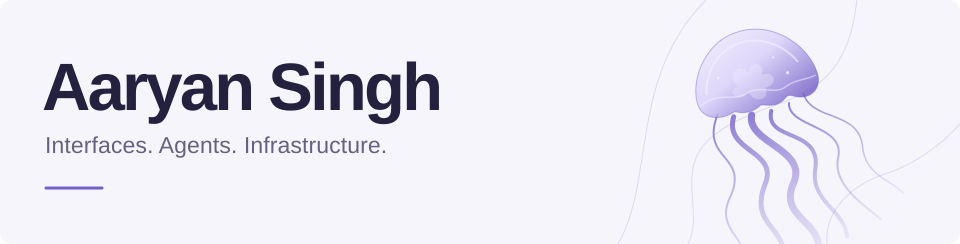

<picture>
  <source media="(prefers-color-scheme: dark)" srcset="assets/header-dark.svg">
  <source media="(prefers-color-scheme: light)" srcset="assets/header-light.svg">
  
</picture>

I build AI agent infrastructure, systems, and developer tools.

Previously, founding engineer at **ReferRush**. I built Shopify integrations, referral flows, and payout systems.

**[Website](https://whiteye.in)** &nbsp; / &nbsp; **[Writing](https://whiteye.in/blog)** &nbsp; / &nbsp; **[Résumé](https://whiteye.in/resume)** &nbsp; / &nbsp; **[Email](mailto:aaryan@whiteye.in)**

## Selected work

<table>
  <tr>
    <td width="50%" valign="top">
      <h3><a href="https://github.com/maskjelly/instantKV">instantKV</a></h3>
      
Local agent memory with BM25 search, durable checkpoints, and MCP.

      
Rust &nbsp; · &nbsp; Source MVP

    </td>
    <td width="50%" valign="top">
      <h3><a href="https://github.com/maskjelly/morse">Morse</a></h3>
      
Remote agent execution, session replay, and a separate agent for progress updates.

      
Rust &nbsp; · &nbsp; Agent runtime

    </td>
  </tr>
  <tr>
    <td width="50%" valign="top">
      <h3><a href="https://github.com/maskjelly/TiVM">TiVM</a></h3>
      
UI testing in disposable Linux desktops, with screenshots, video, and replay.

      
Python &nbsp; · &nbsp; Pre-1.0 prototype

    </td>
    <td width="50%" valign="top">
      <h3><a href="https://github.com/maskjelly/rushort">rushort</a></h3>
      
A small HTTP service with SQLite durability and documented benchmarks.

      
Rust &nbsp; · &nbsp; Systems programming

    </td>
  </tr>
</table>

Also building **[Plain Corners](https://github.com/maskjelly/plain-corners)**, a native macOS window utility. Working preview.

## Open source

Merged contributions to **[Atuin](https://github.com/atuinsh/atuin/pulls?q=is%3Apr+is%3Amerged+author%3Amaskjelly)**, **[Podman Desktop](https://github.com/podman-desktop/podman-desktop/pulls?q=is%3Apr+is%3Amerged+author%3Amaskjelly)**, **[WebTUI](https://github.com/webtui/webtui/pulls?q=is%3Apr+is%3Amerged+author%3Amaskjelly)**, **[iamb](https://github.com/ulyssa/iamb/pulls?q=is%3Apr+is%3Amerged+author%3Amaskjelly)**, and [other projects](https://github.com/pulls?q=is%3Apr+is%3Amerged+author%3Amaskjelly+-user%3Amaskjelly).

  <code>JavaScript</code> <code>TypeScript</code> <code>Python</code> <code>C</code> <code>C++</code> <code>Rust</code>

I also write about storage, distributed systems, and systems programming at [whiteye.in](https://whiteye.in/blog).
